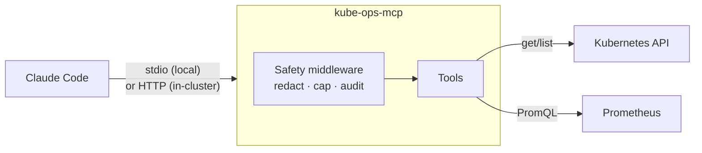

# kube-ops-mcp

An [MCP](https://modelcontextprotocol.io) server that lets AI assistants like Claude Code triage Kubernetes incidents. It is **read-only by default**.

Ask *"Why is payment-service failing in the demo namespace?"* and the assistant checks pod status, events, crash logs and Prometheus metrics, then explains the root cause with evidence:

> **payment-service** is in CrashLoopBackOff: the container exits with code 1 because `DATABASE_URL` is not set (log: `FATAL: required environment variable DATABASE_URL is not set`). Add the variable to the Deployment.

> **Status:** work in progress. CI and release images are next on the [roadmap](#roadmap).

## How it works

The server runs in one of two places:

| Mode | Where it runs | Which cluster it sees | Permissions |
|---|---|---|---|
| **Local** (stdio) | On your machine, started by Claude Code | Your kubeconfig context (pin one with `KUBE_OPS_CONTEXT`) | Your own kubectl permissions |
| **In-cluster** (Streamable HTTP) | As a pod, installed with Helm | The cluster it runs in | Its own read-only ServiceAccount |



Every tool call passes through one middleware that redacts secrets, caps the output size and writes a JSON audit line, so no tool can skip those steps. Every result names the cluster it came from.

It works with any conformant Kubernetes cluster (kind, EKS, GKE, AKS…). Metrics need Prometheus; the queries use the standard cAdvisor and kube-state-metrics series from kube-prometheus-stack. Without Prometheus, every other tool still works and `diagnose_workload` reports the metrics as unavailable.

## Quickstart

Needs Docker, [kind](https://kind.sigs.k8s.io), kubectl, Helm, [uv](https://docs.astral.sh/uv/) and [Claude Code](https://claude.com/claude-code).

```bash
git clone https://github.com/yuvalgraiber/kube-ops-mcp && cd kube-ops-mcp
make install        # Python dependencies from the lock file
make demo-up        # kind cluster + Prometheus + deliberately broken apps
make port-forward   # in a second terminal: Prometheus on localhost:9090
claude              # start it inside the repo, approve the kube-ops server, then: /triage payment-service
```

The demo namespace contains two broken apps and one healthy app:

| App | Failure | Cause |
|---|---|---|
| `payment-service` | CrashLoopBackOff | A required environment variable is missing |
| `recommendation-service` | OOMKilled | It uses about 150 MiB against a 64 MiB limit |
| `frontend` | none | Healthy baseline |

## Run it in your cluster

```bash
make deploy              # build the image, load it into the kind demo cluster, install the chart, run helm test
make port-forward-mcp    # in a second terminal: the in-cluster server on localhost:8000
claude mcp add --transport http kube-ops-cluster http://localhost:8000/mcp
```

For another cluster, push the image to your registry and install the chart:

```bash
helm install kube-ops-mcp deploy/helm/kube-ops-mcp -n kube-ops --create-namespace \
  --set image.repository=<registry>/kube-ops-mcp --set image.tag=<tag> \
  --set clusterName=prod-eu \
  --set prometheus.url=http://prometheus-operated.monitoring.svc:9090
```

What the chart sets up:
- **RBAC:** a ClusterRole with `get`/`list` on pods, pod logs, events, namespaces, nodes, deployments and replicasets, and **no access to secrets or configmaps**. With `write.enabled=true`, it adds a namespaced Role that can only `patch` deployments, and only in each `write.allowedNamespaces` entry.
- **Hardened pod:** non-root UID 10001, read-only root filesystem, all Linux capabilities dropped, no privilege escalation, `RuntimeDefault` seccomp, and liveness and readiness probes.
- **Network:** a ClusterIP Service only, plus a NetworkPolicy that accepts traffic only from pods labelled `kube-ops-mcp-client: "true"`. The MCP endpoint has no login of its own, so it is never exposed outside the cluster; `kubectl port-forward` already requires RBAC on `pods/portforward`. DNS-rebinding protection rejects unknown `Host` headers.
- **Image:** multi-stage build from `uv.lock`, base images pinned by digest, about 70 MB to pull.

## Tools

| Tool | What it returns | Access |
|---|---|---|
| `diagnose_workload` | One-call investigation: status, events, crash logs, CPU/memory vs. limits, ranked findings with evidence and a fix | read |
| `get_pod_status` | Headline status per pod as `kubectl` shows it, restarts, last termination reason and exit code | read |
| `get_recent_events` | Warning events in a time window, newest first | read |
| `get_pod_logs` | Last N log lines, including the previous (crashed) container | read |
| `query_prometheus` | Instant or range PromQL, with an automatic step and a 50-series cap | read |
| `restart_deployment` | Rolling restart, like `kubectl rollout restart` | write, off by default |
| `scale_deployment` | Replica count within 1 to `KUBE_OPS_MAX_REPLICAS` | write, off by default |

The server also provides:
- the **resource** `cluster://summary` (Kubernetes version, node readiness, namespaces)
- the **prompt** `incident_triage` (a fixed order: status → events → logs → metrics → hypothesis)
- the Claude Code **slash command** `/triage <deployment> [namespace]`

## Security model

- **Read-only by default.** Write tools are only registered when `KUBE_OPS_ENABLE_WRITE=true`.
- **Namespace allow-list.** Write tools only act in namespaces listed in `ALLOWED_NAMESPACES`. Other requests are refused before anything is asked or changed.
- **Human confirmation.** Every write asks the user to approve it through MCP elicitation. If the client cannot ask, the write is refused (fail closed).
- **Bounded changes.** Scaling is limited to 1 to `KUBE_OPS_MAX_REPLICAS`, so scaling to 0 isn't allowed.
- **Secret redaction.** The tokens, passwords, keys and URL credentials that tools return are masked before they reach the model.
- **Output caps.** Large results are truncated so they don't flood the model's context.
- **Audit log.** One JSON line per tool call (tool, redacted arguments, outcome, duration) goes to stderr, ready for any log collector.
- **Timeouts everywhere.** Every Kubernetes and Prometheus call has a timeout, and failures return an actionable message.
- **Input validation.** Names are checked against Kubernetes naming rules before any API call.

## Configuration

All settings come from environment variables.

| Variable | Default | Purpose |
|---|---|---|
| `PROMETHEUS_URL` | `http://localhost:9090` | Prometheus base URL |
| `KUBE_OPS_K8S_TIMEOUT` | `10` | Kubernetes API timeout, in seconds |
| `KUBE_OPS_PROMETHEUS_TIMEOUT` | `10` | Prometheus timeout, in seconds |
| `KUBE_OPS_ENABLE_WRITE` | `false` | Register the write tools |
| `ALLOWED_NAMESPACES` | *(empty)* | Comma-separated namespaces that write tools may change |
| `KUBE_OPS_MAX_REPLICAS` | `10` | Upper bound for `scale_deployment` |
| `KUBE_OPS_REQUIRE_CONFIRMATION` | `true` | Refuse writes when the client cannot ask the user to confirm |
| `KUBE_OPS_CONTEXT` | *(current context)* | Pin the kubeconfig context, so a local run never targets the wrong cluster |
| `KUBE_OPS_CLUSTER_NAME` | *(context or `in-cluster`)* | Cluster name reported in results |
| `KUBE_OPS_TRANSPORT` | `stdio` | `stdio` for a local client, `http` for Streamable HTTP (the container default) |
| `KUBE_OPS_HOST` / `KUBE_OPS_PORT` | `127.0.0.1` / `8000` | HTTP listen address |
| `KUBE_OPS_ALLOWED_HOSTS` | `localhost:*,127.0.0.1:*` | Accepted `Host` headers over HTTP (DNS-rebinding protection) |

Kubernetes credentials come from the in-cluster service account, or from your kubeconfig when running locally.

## Development

```bash
make help    # list all tasks
make check   # ruff lint + format check + helm lint + pytest with an 85% coverage gate
make inspector   # open MCP Inspector against the server
```

The tests mock the Kubernetes API and Prometheus, so no cluster is needed. The server tests drive the real MCP protocol through the SDK's in-memory client, so the middleware and elicitation code paths run for real.

## Roadmap

- [x] Container image, Streamable HTTP transport and a Helm chart with least-privilege RBAC
- [ ] Authentication for the HTTP endpoint (OAuth, supported by the MCP spec)
- [ ] GitHub Actions: lint, tests, `helm lint`, image build and push to GHCR, kind smoke test
- [ ] Demo GIF
- [ ] LLM log summarization through MCP sampling, once clients support it

## License

[MIT](LICENSE)
