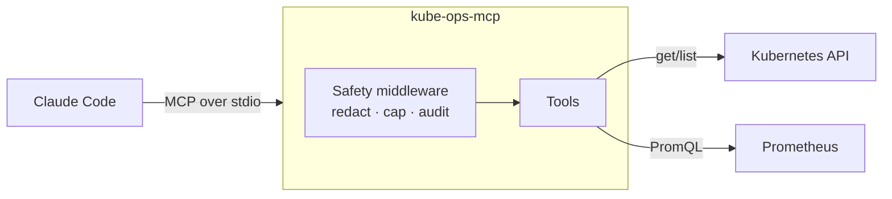

# kube-ops-mcp

An [MCP](https://modelcontextprotocol.io) server that lets AI assistants like Claude Code triage Kubernetes incidents. It is **read-only by default**.

Ask *"Why is payment-service failing in the demo namespace?"* and the assistant checks pod status, events, crash logs and Prometheus metrics, then explains the root cause with evidence:

> **payment-service** is in CrashLoopBackOff: the container exits with code 1 because `DATABASE_URL` is not set (log: `FATAL: required environment variable DATABASE_URL is not set`). Add the variable to the Deployment.

> **Status:** work in progress. In-cluster deployment (Helm chart) and CI are next on the [roadmap](#roadmap).

## How it works



Every tool call passes through one middleware that redacts secrets, caps the output size and writes a JSON audit line, so no tool can skip those steps.

## Quickstart

Needs Docker, [kind](https://kind.sigs.k8s.io), kubectl, Helm, [uv](https://docs.astral.sh/uv/) and [Claude Code](https://claude.com/claude-code).

```bash
git clone https://github.com/yuvalgraiber/kube-ops-mcp && cd kube-ops-mcp
make install        # Python dependencies from the lock file
make demo-up        # kind cluster + Prometheus + deliberately broken apps
make port-forward   # in a second terminal: Prometheus on localhost:9090
claude              # .mcp.json registers the server; try /triage payment-service
```

The demo namespace contains two broken apps and one healthy app:

| App | Failure | Cause |
|---|---|---|
| `payment-service` | CrashLoopBackOff | A required environment variable is missing |
| `recommendation-service` | OOMKilled | It uses about 150 MiB against a 64 MiB limit |
| `frontend` | none | Healthy baseline |

## Tools

| Tool | What it returns | Access |
|---|---|---|
| `diagnose_workload` | One-call investigation: status, events, crash logs, CPU/memory vs. limits, ranked findings with evidence and a fix | read |
| `get_pod_status` | Headline status per pod as `kubectl` shows it, restarts, last termination reason and exit code | read |
| `get_recent_events` | Warning events in a time window, newest first | read |
| `get_pod_logs` | Last N log lines, including the previous (crashed) container | read |
| `query_prometheus` | Instant or range PromQL, with an automatic step and a 50-series cap | read |
| `restart_deployment` | Rolling restart, like `kubectl rollout restart` | write, off by default |
| `scale_deployment` | Replica count within 1 to `KUBE_OPS_MAX_REPLICAS` | write, off by default |

The server also provides:
- the **resource** `cluster://summary` (Kubernetes version, node readiness, namespaces)
- the **prompt** `incident_triage` (a fixed order: status → events → logs → metrics → hypothesis)
- the Claude Code **slash command** `/triage <deployment> [namespace]`

## Security model

- **Read-only by default.** Write tools are only registered when `KUBE_OPS_ENABLE_WRITE=true`.
- **Namespace allow-list.** Write tools only act in namespaces listed in `ALLOWED_NAMESPACES`. Other requests are refused before anything is asked or changed.
- **Human confirmation.** Every write asks the user to approve it through MCP elicitation. If the client cannot ask, the write is refused (fail closed).
- **Bounded changes.** Scaling is limited to 1 to `KUBE_OPS_MAX_REPLICAS`, so scaling to 0 isn't allowed.
- **Secret redaction.** The tokens, passwords, keys and URL credentials that tools return are masked before they reach the model.
- **Output caps.** Large results are truncated so they don't flood the model's context.
- **Audit log.** One JSON line per tool call (tool, redacted arguments, outcome, duration) goes to stderr, ready for any log collector.
- **Timeouts everywhere.** Every Kubernetes and Prometheus call has a timeout, and failures return an actionable message.
- **Input validation.** Names are checked against Kubernetes naming rules before any API call.

## Configuration

All settings come from environment variables.

| Variable | Default | Purpose |
|---|---|---|
| `PROMETHEUS_URL` | `http://localhost:9090` | Prometheus base URL |
| `KUBE_OPS_K8S_TIMEOUT` | `10` | Kubernetes API timeout, in seconds |
| `KUBE_OPS_PROMETHEUS_TIMEOUT` | `10` | Prometheus timeout, in seconds |
| `KUBE_OPS_ENABLE_WRITE` | `false` | Register the write tools |
| `ALLOWED_NAMESPACES` | *(empty)* | Comma-separated namespaces that write tools may change |
| `KUBE_OPS_MAX_REPLICAS` | `10` | Upper bound for `scale_deployment` |
| `KUBE_OPS_REQUIRE_CONFIRMATION` | `true` | Refuse writes when the client cannot ask the user to confirm |

Kubernetes credentials come from the in-cluster service account, or from your kubeconfig when running locally.

## Development

```bash
make help    # list all tasks
make check   # ruff lint + format check + pytest (what CI runs)
make inspector   # open MCP Inspector against the server
```

The tests mock the Kubernetes API and Prometheus, so no cluster is needed. The server tests drive the real MCP protocol through the SDK's in-memory client, so the middleware and elicitation code paths run for real.

## Roadmap

- [ ] Container image, Streamable HTTP transport and a Helm chart with least-privilege RBAC
- [ ] GitHub Actions: lint, tests, `helm lint`, image build and push to GHCR, kind smoke test
- [ ] Demo GIF
- [ ] LLM log summarization through MCP sampling, once clients support it

## License

[MIT](LICENSE)
