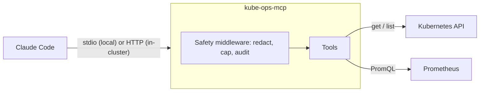

# kube-ops-mcp

[](https://github.com/yuvalgraiber/kube-ops-mcp/actions/workflows/ci.yml)
[](https://github.com/yuvalgraiber/kube-ops-mcp/releases)
[](LICENSE)


An MCP server that lets Claude Code (or any MCP client) investigate a broken Kubernetes workload the way an on-call engineer would: pod status, events, crash logs and Prometheus metrics, then a root cause with the evidence behind it. It is read-only unless you explicitly turn writes on.


- [Why](#why)
- [Requirements](#requirements)
- [Try the demo](#try-the-demo) (5 minutes, nothing to configure)
- [Use it with your own cluster](#use-it-with-your-own-cluster) (from your machine)
- [Install it in a cluster](#install-it-in-a-cluster) (for a team)
- [Other MCP clients](#other-mcp-clients) (Claude Desktop, Cursor, VS Code)
- [What to ask](#what-to-ask) · [Write tools](#write-tools) · [Troubleshooting](#troubleshooting) · [Configuration](#configuration)
- [How it works](#how-it-works) · [Safety](#safety) · [Design notes](#design-notes) · [Development](#development)

## Why

When a pod crash-loops at 3am, the first ten minutes are always the same: `kubectl get pods`, `describe`, `logs --previous`, check the events, open Grafana to see whether memory hit the limit. None of it is hard, but it's slow and easy to get wrong when you're tired.

I wanted an assistant that runs that loop for me and shows its work, without giving an AI write access to a cluster. So the server only reads by default, and the two write actions it has are fenced in by an allow-list and a confirmation prompt.

## Requirements

| For | You need |
|---|---|
| Every setup | [Claude Code](https://code.claude.com/docs) or another MCP client, and [uv](https://docs.astral.sh/uv/getting-started/installation/) |
| Your own cluster | `kubectl` access to it, and optionally Prometheus for CPU and memory |
| The demo | Docker, [kind](https://kind.sigs.k8s.io/docs/user/quick-start/#installation), `kubectl` and Helm |

On macOS: `brew install uv kind kubectl helm`. On Linux, use the links above. On Windows, use WSL2.

## Try the demo

The demo creates a local kind cluster with Prometheus and three apps, two of them broken on purpose.

```bash
git clone https://github.com/yuvalgraiber/kube-ops-mcp && cd kube-ops-mcp
make install        # Python dependencies from uv.lock
make demo-up        # kind cluster + Prometheus + demo apps (takes a few minutes)
make port-forward   # leave this running in a second terminal (Prometheus on :9090)
claude              # start it inside the repo folder
```

The first time, Claude Code asks whether to use the `kube-ops` server from the project's `.mcp.json`. Approve it, check that `/mcp` shows it as connected, then run `/triage payment-service`.

| App | What you'll see | Why |
|---|---|---|
| `payment-service` | CrashLoopBackOff | `DATABASE_URL` is missing, so it exits with code 1 |
| `recommendation-service` | OOMKilled | It allocates ~150 MiB with a 64 MiB limit |
| `frontend` | Running | Healthy, for comparison |

`make demo-down` deletes the cluster when you're done.

## Use it with your own cluster

You don't need to clone anything. Add the server to Claude Code once, and it's available in every project:

```bash
claude mcp add kube-ops --scope user \
  -e KUBE_OPS_CONTEXT=my-cluster-context \
  -e PROMETHEUS_URL=http://localhost:9090 \
  -- uvx --from git+https://github.com/yuvalgraiber/kube-ops-mcp@v0.1.2 kube-ops-mcp
```

- `KUBE_OPS_CONTEXT` is the kubeconfig context to use (`kubectl config get-contexts`). Pinning it means the server can't wander off to another cluster when you switch contexts in your terminal. Leave it out to use your current context.
- The server has the same permissions as your kubeconfig user. A read-only user is a good idea.
- For metrics, make Prometheus reachable, for example `kubectl -n monitoring port-forward svc/prometheus-operated 9090`, and set `PROMETHEUS_URL` to match. Without Prometheus, everything except the metrics still works.

Then open Claude Code anywhere and ask about your cluster. `claude mcp remove kube-ops --scope user` removes it again.

## Install it in a cluster

For a team, run the server once inside the cluster with its own read-only ServiceAccount, instead of everyone using their own credentials.

```bash
helm install kube-ops-mcp oci://ghcr.io/yuvalgraiber/charts/kube-ops-mcp --version 0.1.2 \
  -n kube-ops --create-namespace \
  --set clusterName=prod-eu \
  --set prometheus.url=http://prometheus-operated.monitoring.svc:9090

helm test kube-ops-mcp -n kube-ops   # checks the server answers through its Service
```

The server has no login of its own, so the chart only exposes it inside the cluster. To connect from your machine:

```bash
kubectl -n kube-ops port-forward svc/kube-ops-mcp 8000:8000
claude mcp add --transport http kube-ops-cluster http://localhost:8000/mcp
```

Pods that need to call it directly must carry the label `kube-ops-mcp-client: "true"`; the NetworkPolicy blocks everything else. All chart options are in [`values.yaml`](deploy/helm/kube-ops-mcp/values.yaml). To try the chart on the demo cluster from a clone, run `make deploy`, which builds the image locally, installs the chart and runs `helm test`.

The chart gives the server a ClusterRole that can only `get` and `list` pods, pod logs, events, namespaces, nodes, deployments and replicasets. It can't read Secrets or ConfigMaps. The pod runs as a non-root user with a read-only filesystem and no Linux capabilities.

## Other MCP clients

Any client that can start a stdio MCP server works. For Claude Desktop, Cursor or VS Code, add this to the client's MCP config file:

```json
{
  "mcpServers": {
    "kube-ops": {
      "command": "uvx",
      "args": ["--from", "git+https://github.com/yuvalgraiber/kube-ops-mcp@v0.1.2", "kube-ops-mcp"],
      "env": {
        "KUBE_OPS_CONTEXT": "my-cluster-context",
        "PROMETHEUS_URL": "http://localhost:9090"
      }
    }
  }
}
```

Desktop apps don't always see your shell's `PATH`. If the server doesn't start, replace `uvx` with its full path (`which uvx`).

## What to ask

Plain questions work:

- *Why is payment-service failing in the demo namespace?*
- *Is anything unhealthy in staging?*
- *Is checkout close to its memory limit? Show the last hour.*
- *What happened in the payments namespace in the last 30 minutes?*

In a clone of this repo, `/triage <deployment> [namespace]` runs a full investigation and answers with a root cause, evidence and a fix. Other clients can use the `incident_triage` prompt the same way.

| Tool | What it does |
|---|---|
| `diagnose_workload` | Investigates a Deployment in one call and returns ranked findings, each with evidence and a suggested fix |
| `get_pod_status` | Pod status the way `kubectl get pods` shows it, plus restarts and the last exit reason |
| `get_recent_events` | Warning events from a time window, newest first |
| `get_pod_logs` | The last N log lines, from the current or the previous (crashed) container |
| `query_prometheus` | Any PromQL query, instant or over a time range |
| `restart_deployment` | Rolling restart. Write tool, off by default |
| `scale_deployment` | Changes replicas within a fixed range. Write tool, off by default |

There's also a `cluster://summary` resource with the Kubernetes version, node readiness and namespaces.

## Write tools

`restart_deployment` and `scale_deployment` stay hidden from the model until you turn them on, and then only work in the namespaces you list:

```bash
# local
claude mcp add kube-ops --scope user \
  -e KUBE_OPS_ENABLE_WRITE=true -e ALLOWED_NAMESPACES=staging,dev \
  -- uvx --from git+https://github.com/yuvalgraiber/kube-ops-mcp@v0.1.2 kube-ops-mcp

# in a cluster (also creates a Role that can only patch deployments, in those namespaces only)
helm upgrade kube-ops-mcp oci://ghcr.io/yuvalgraiber/charts/kube-ops-mcp --version 0.1.2 -n kube-ops \
  --reuse-values --set write.enabled=true --set 'write.allowedNamespaces={staging,dev}'
```

Every write still asks you to confirm in the client before anything changes. Clients that can't show that prompt are refused (see [Safety](#safety)).

## Troubleshooting

| Problem | What to check |
|---|---|
| `/triage` is an unknown command | Start `claude` inside the repo folder. Project commands only load there. |
| `kube-ops` shows as pending or isn't listed in `/mcp` | Approve it when Claude Code asks, or check `claude mcp list` |
| "No Kubernetes credentials" | `kubectl config get-contexts`, and that `KUBE_OPS_CONTEXT` names a real context |
| "Could not connect to Prometheus" | The port-forward stopped, or `PROMETHEUS_URL` points somewhere else. Other tools keep working. |
| Memory peak says "not captured" | The container dies before Prometheus scrapes it (every 30s). The OOMKilled reason is still reported. |
| "Not changed: this MCP client cannot ask you to confirm" | Your client doesn't support elicitation. Use Claude Code, or read [Safety](#safety) before setting `KUBE_OPS_REQUIRE_CONFIRMATION=false`. |
| HTTP requests get `421 Misdirected Request` | The Host header isn't allowed. Add the name you use to `extraAllowedHosts` in the chart values. |

## Configuration

Everything is set with environment variables. The Helm chart sets them from its values.

| Variable | Default | |
|---|---|---|
| `PROMETHEUS_URL` | `http://localhost:9090` | Prometheus base URL |
| `KUBE_OPS_CONTEXT` | current context | Kubeconfig context to use |
| `KUBE_OPS_CLUSTER_NAME` | context name, or `in-cluster` | Name shown in results |
| `KUBE_OPS_ENABLE_WRITE` | `false` | Register the write tools |
| `ALLOWED_NAMESPACES` | empty | Comma-separated namespaces the write tools may change |
| `KUBE_OPS_MAX_REPLICAS` | `10` | Upper bound for `scale_deployment` |
| `KUBE_OPS_REQUIRE_CONFIRMATION` | `true` | Refuse writes when the client can't ask for confirmation |
| `KUBE_OPS_K8S_TIMEOUT`, `KUBE_OPS_PROMETHEUS_TIMEOUT` | `10` | Timeouts in seconds |
| `KUBE_OPS_TRANSPORT` | `stdio` | `http` for Streamable HTTP (the container default) |
| `KUBE_OPS_HOST`, `KUBE_OPS_PORT` | `127.0.0.1`, `8000` | HTTP listen address |
| `KUBE_OPS_ALLOWED_HOSTS` | `localhost:*,127.0.0.1:*` | Host headers accepted over HTTP |

## How it works

The client starts the server (or connects to it over HTTP) and talks to it over MCP. The server talks to the Kubernetes API and Prometheus, and every tool call goes through one middleware layer that masks secrets, caps the response size and writes an audit line.



| | Local | In the cluster |
|---|---|---|
| Runs as | A process your MCP client starts (stdio) | A pod installed with Helm (Streamable HTTP) |
| Sees | `KUBE_OPS_CONTEXT`, or your current kubeconfig context | The cluster it runs in |
| Permissions | Whatever your kubeconfig user can do | Its own read-only ServiceAccount |

Any conformant cluster works (kind, EKS, GKE, AKS). The metric queries use the standard cAdvisor and kube-state-metrics series that kube-prometheus-stack ships, and every result names the cluster it came from.

## Safety

I treated the model as an untrusted caller:

- Write tools aren't registered unless `KUBE_OPS_ENABLE_WRITE=true`, so the model doesn't know they exist.
- Writes only work in `ALLOWED_NAMESPACES`, and that check runs before anything else.
- Every write asks you to confirm through MCP elicitation. If the client can't ask, the write is refused instead of allowed.
- Scaling is limited to 1 to `KUBE_OPS_MAX_REPLICAS`. Scaling to zero is an outage, so it's not allowed.
- Tokens, passwords, keys and credentials in URLs are masked in every response before the model sees them. Logs leak secrets more often than people expect.
- Responses are capped at 25k characters, and every call writes one JSON audit line to stderr.

See [SECURITY.md](SECURITY.md) to report a problem.

## Design notes

A few decisions that weren't obvious:

- **A pod that's Running can still be unhealthy.** An OOMKilled container restarts and looks fine for a few seconds. Any container that restarted in the last 15 minutes counts as unhealthy, otherwise the most common failure would be missed half the time.
- **Crash logs aren't always in `--previous`.** While a container is between restarts, its own logs are the crash logs, and the previous instance may already be gone. `diagnose_workload` picks the right one and falls back if it has to.
- **Fail closed on confirmation.** Not every MCP client supports elicitation. Allowing writes anyway would make the confirmation step decorative.
- **One replica.** Streamable HTTP keeps MCP sessions in memory, so the chart runs a single pod. A triage tool doesn't need more.
- **No CPU limit in the chart.** It only causes throttling. Memory is limited.
- **No sampling yet.** I wanted the server to summarize long logs with the client's model, but Claude Code doesn't support MCP sampling yet.

## Development

```bash
make help       # all tasks
make check      # ruff, mypy, helm lint, pytest (fails under 85% coverage)
make inspector  # MCP Inspector against the local server
```

The tests don't need a cluster. Kubernetes and Prometheus are mocked, and the server tests go through the SDK's in-memory MCP client, so the middleware and the confirmation flow run for real.

CI runs the checks on Python 3.12, 3.13 and 3.14, then builds the image, fails on fixable HIGH or CRITICAL CVEs (Trivy), installs the chart on a kind cluster with the demo apps, checks that the ServiceAccount really is read-only and drives the server over MCP with [`scripts/smoke_test.py`](scripts/smoke_test.py). Pushing a `vX.Y.Z` tag publishes multi-arch images with an SBOM and signed provenance, the chart and the release notes from [CHANGELOG.md](CHANGELOG.md).

CodeQL scans the Python code and the workflows, Dependabot keeps dependencies and pinned actions current, and secret scanning with push protection is on for the repository.

See [CONTRIBUTING.md](CONTRIBUTING.md) if you'd like to help.

## Built with

I built this after finishing Anthropic's MCP and Claude Code courses, and it uses most of what they cover:

- **Introduction to Model Context Protocol:** tools, a resource and a prompt ([`server.py`](src/kube_ops_mcp/server.py))
- **Model Context Protocol: Advanced topics:** Streamable HTTP, progress notifications, elicitation for confirmations, and server middleware ([`safety.py`](src/kube_ops_mcp/safety.py))
- **Claude Code in action:** the project [`.mcp.json`](.mcp.json), the [`/triage`](.claude/commands/triage.md) command and [`CLAUDE.md`](CLAUDE.md)

## Roadmap

- OAuth for the HTTP endpoint (part of the MCP spec), so it can be exposed beyond port-forward
- Log summarization with MCP sampling, once clients support it
- More findings: failing probes with their config, pending PVCs, node pressure

## License

[MIT](LICENSE)
