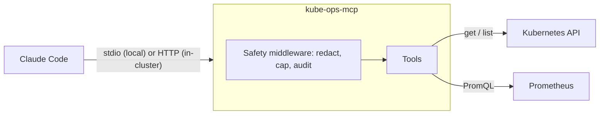

# kube-ops-mcp

[](https://github.com/yuvalgraiber/kube-ops-mcp/actions/workflows/ci.yml)
[](LICENSE)


An MCP server that lets Claude Code (or any MCP client) investigate a broken Kubernetes workload the way an on-call engineer would: pod status, events, crash logs and Prometheus metrics, then a root cause with the evidence behind it. It is read-only unless you explicitly turn writes on.


## Why

When a pod crash-loops at 3am, the first ten minutes are always the same: `kubectl get pods`, `describe`, `logs --previous`, check the events, open Grafana to see whether memory hit the limit. None of it is hard, but it's slow and easy to get wrong when you're tired.

I wanted an assistant that does that loop for me and shows its work, without giving an AI write access to a cluster. So the server only reads by default, and the few write actions it has are fenced in by an allow-list and a confirmation prompt.

## Try it

You need Docker, [kind](https://kind.sigs.k8s.io), kubectl, Helm, [uv](https://docs.astral.sh/uv/) and [Claude Code](https://claude.com/claude-code).

```bash
git clone https://github.com/yuvalgraiber/kube-ops-mcp && cd kube-ops-mcp
make install        # Python dependencies from uv.lock
make demo-up        # kind cluster, Prometheus and three demo apps
make port-forward   # keep running in a second terminal (Prometheus on :9090)
claude              # run it from the repo folder and approve the kube-ops server
```

Then ask *"why is payment-service failing in demo?"* or run `/triage payment-service`.

The demo namespace has two apps that are broken on purpose and one healthy one to compare against:

| App | What you'll see | Why |
|---|---|---|
| `payment-service` | CrashLoopBackOff | `DATABASE_URL` is missing, so it exits with code 1 |
| `recommendation-service` | OOMKilled | It allocates ~150 MiB with a 64 MiB limit |
| `frontend` | Running | Healthy baseline |

## How it works

Claude Code starts the server and talks to it over MCP. The server talks to the Kubernetes API and Prometheus, and every tool call goes through one middleware layer that masks secrets, caps the response size and writes an audit line.



It can run in two places:

| | Local | In the cluster |
|---|---|---|
| Runs as | A process Claude Code starts on your machine (stdio) | A pod installed with Helm (Streamable HTTP) |
| Sees | Your current kubeconfig context, or the one in `KUBE_OPS_CONTEXT` | The cluster it runs in |
| Permissions | Whatever your kubeconfig user can do | Its own read-only ServiceAccount |

Any conformant cluster works (kind, EKS, GKE, AKS). The metric queries use the standard cAdvisor and kube-state-metrics series that kube-prometheus-stack ships. If there's no Prometheus, the other tools keep working and `diagnose_workload` says the metrics are unavailable instead of failing.

### Tools

| Tool | What it does |
|---|---|
| `diagnose_workload` | Investigates a Deployment in one call and returns ranked findings, each with evidence and a suggested fix |
| `get_pod_status` | Pod status the way `kubectl get pods` shows it, plus restarts and the last exit reason |
| `get_recent_events` | Warning events from a time window, newest first |
| `get_pod_logs` | The last N log lines, from the current or the previous (crashed) container |
| `query_prometheus` | Any PromQL query, instant or over a time range |
| `restart_deployment` | Rolling restart. Write tool, off by default |
| `scale_deployment` | Changes replicas within a fixed range. Write tool, off by default |

There's also a `cluster://summary` resource, an `incident_triage` prompt, and the `/triage` slash command for Claude Code in `.claude/commands/`.

## Running it in a cluster

```bash
make deploy             # build the image, load it into kind, install the chart, run helm test
make port-forward-mcp   # second terminal
claude mcp add --transport http kube-ops-cluster http://localhost:8000/mcp
```

For a real cluster, install the published chart and image:

```bash
helm install kube-ops-mcp oci://ghcr.io/yuvalgraiber/charts/kube-ops-mcp --version 0.1.0 \
  -n kube-ops --create-namespace \
  --set clusterName=prod-eu \
  --set prometheus.url=http://prometheus-operated.monitoring.svc:9090
```

The chart gives the server a ClusterRole that can only `get` and `list` pods, logs, events, namespaces, nodes, deployments and replicasets. It can't read Secrets or ConfigMaps. The pod runs as a non-root user with a read-only filesystem and no Linux capabilities. The Service is ClusterIP only, and a NetworkPolicy lets in only pods labelled `kube-ops-mcp-client: "true"`.

## Safety

I treated the model as an untrusted caller. Concretely:

- Write tools aren't even registered unless `KUBE_OPS_ENABLE_WRITE=true`, so the model can't see them.
- Writes only work in namespaces listed in `ALLOWED_NAMESPACES`, and that check runs before anything else.
- Every write asks you to confirm through MCP elicitation. If the client can't ask, the write is refused rather than allowed.
- Scaling is limited to 1 to `KUBE_OPS_MAX_REPLICAS`. Scaling to zero is an outage, so it's not allowed.
- Tokens, passwords, keys and credentials in URLs are masked in every response before the model sees them. Logs leak secrets more often than people expect.
- Responses are capped at 25k characters, and every call writes one JSON audit line to stderr.

## Design notes

A few decisions that weren't obvious:

- **A pod that's Running can still be unhealthy.** An OOMKilled container restarts and looks fine for a few seconds. Any container that restarted in the last 15 minutes counts as unhealthy, otherwise the most common failure would be missed half the time.
- **Crash logs aren't always in `--previous`.** While a container is between restarts, its own logs are the crash logs, and the previous instance may already be gone. `diagnose_workload` picks the right one and falls back if it has to.
- **Fail closed on confirmation.** Not every MCP client supports elicitation. Allowing writes anyway would make the confirmation step decorative.
- **One replica.** Streamable HTTP keeps MCP sessions in memory, so the chart runs a single pod. A triage tool doesn't need more.
- **No CPU limit in the chart.** It only causes throttling. Memory is limited.
- **No sampling.** I wanted the server to summarize long logs with the client's model, but Claude Code doesn't support MCP sampling yet, so it's on the roadmap instead.

## Configuration

Everything is configured through environment variables (Helm values set them for you).

| Variable | Default | |
|---|---|---|
| `PROMETHEUS_URL` | `http://localhost:9090` | Prometheus base URL |
| `KUBE_OPS_CONTEXT` | current context | Pin a kubeconfig context so a local run can't hit the wrong cluster |
| `KUBE_OPS_CLUSTER_NAME` | context name, or `in-cluster` | Name shown in results |
| `KUBE_OPS_ENABLE_WRITE` | `false` | Register the write tools |
| `ALLOWED_NAMESPACES` | empty | Comma-separated namespaces the write tools may touch |
| `KUBE_OPS_MAX_REPLICAS` | `10` | Upper bound for `scale_deployment` |
| `KUBE_OPS_REQUIRE_CONFIRMATION` | `true` | Refuse writes when the client can't ask for confirmation |
| `KUBE_OPS_K8S_TIMEOUT`, `KUBE_OPS_PROMETHEUS_TIMEOUT` | `10` | Timeouts in seconds |
| `KUBE_OPS_TRANSPORT` | `stdio` | `http` for Streamable HTTP (the container default) |
| `KUBE_OPS_HOST`, `KUBE_OPS_PORT` | `127.0.0.1`, `8000` | HTTP listen address |
| `KUBE_OPS_ALLOWED_HOSTS` | `localhost:*,127.0.0.1:*` | Host headers accepted over HTTP |

## Development

```bash
make help       # all tasks
make check      # ruff, helm lint, pytest (fails under 85% coverage)
make inspector  # MCP Inspector against the local server
```

The tests don't need a cluster. Kubernetes and Prometheus are mocked, and the server tests go through the SDK's in-memory MCP client, so the middleware and the confirmation flow run for real. CI also builds the image, scans it with Trivy, installs the chart on a kind cluster and runs [`scripts/smoke_test.py`](scripts/smoke_test.py) against it.

## Built with

I built this after finishing Anthropic's MCP and Claude Code courses, and it uses most of what they cover:

- **Introduction to Model Context Protocol:** tools, a resource and a prompt ([`server.py`](src/kube_ops_mcp/server.py))
- **Model Context Protocol: Advanced topics:** Streamable HTTP, progress notifications, elicitation for confirmations, and server middleware ([`safety.py`](src/kube_ops_mcp/safety.py))
- **Claude Code in action:** the project `.mcp.json`, the `/triage` command and [`CLAUDE.md`](CLAUDE.md). I also used Claude Code throughout development.

## Roadmap

- OAuth for the HTTP endpoint (part of the MCP spec), so it can be exposed beyond port-forward
- Log summarization with MCP sampling, once clients support it
- More findings: failing probes with the probe config, pending PVCs, node pressure

## License

[MIT](LICENSE)
